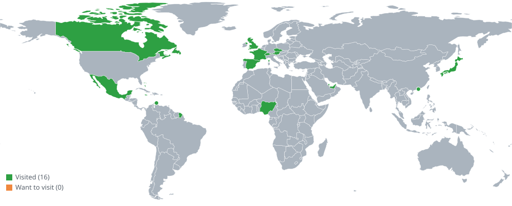

<!-- GREETING:START -->

<!-- GREETING:END -->

<b>I'm Soughtout Olasupo-Ojo</b>

I build full-stack apps and AI-powered tools, from a personal-agent app to a WebGL color explorer. I like turning messy problems into simple, useful software.

- 🔎 **Open to:** Full-Stack, Backend, Systems Test, and AI Engineering roles
- 📫 **Reach me:** [sotout02@gmail.com](mailto:sotout02@gmail.com)

<table>
<tr>
<td valign="top" width="58%">

## 🛠️ Skills

| Area | Tools |
|------|-------|
| **Languages** | Python, Java, C, JavaScript, TypeScript, HTML, CSS, Go *(learning)* |
| **Frameworks & Libraries** | React, Expo, Asyncio, JUnit |
| **Data & AI** | Supabase (PostgreSQL), Anthropic API |
| **DevOps & Tools** | Docker, Git, Kubernetes, Postman, Maven, Bugzilla |

## 🚀 Currently working on

- **Wildcard** – Personal-agent app (React Native/Expo, TypeScript, Supabase) with an always-on Anthropic-powered assistant and per-user row-level security.
- **Film Log** – Offline-first app for film photographers with bulk scan import, GPS location tagging, and achievements.
- **OPTCG Match Sim** – Java rules engine and practice tool for a trading card game, backed by a text-to-game-logic pipeline and 370 JUnit tests.
- **ColorVerse** – WebGL color-space explorer (JavaScript, Three.js) for browsing RGB and HSL as 1-D, 2-D, and 3-D shapes.

## 🌱 Currently learning

- 🐹 **Go** – picking up the language for backend and systems work
- 🤖 **Machine Learning** – working through the Codecademy course

## 🎹 Outside of coding

| | |
|---|---|
| 🎹 **Music** | Keyboard / keytar player with perfect pitch |
| 📷 **Film photography** | Started in March 2026 and still learning. Want photos taken? Hit me up for a photoshoot! |
| 📚 **Manga & anime** | Avid fan |

</td>
<td valign="top" width="42%">

## 🎧 Currently listening to

## 💬 Ask me about

- Film photography and film cameras
- Keyboards and keytars
- Manga and anime
- Building AI-powered apps
- Music

## ⚡ Fun facts

- 🎹 I have perfect pitch
- 🌍 I've been to 16 different countries

## 🤝 Connect

</td>
</tr>
</table>

<!--
**Son9502/Son9502** is a ✨ _special_ ✨ repository because its `README.md` (this file) appears on your GitHub profile.

Here are some ideas to get you started:

- 🔭 I’m currently working on ...
- 🌱 I’m currently learning ...
- 👯 I’m looking to collaborate on ...
- 🤔 I’m looking for help with ...
- 💬 Ask me about ...
- 📫 How to reach me: ...
- 😄 Pronouns: ...
- ⚡ Fun fact: ...
-->
